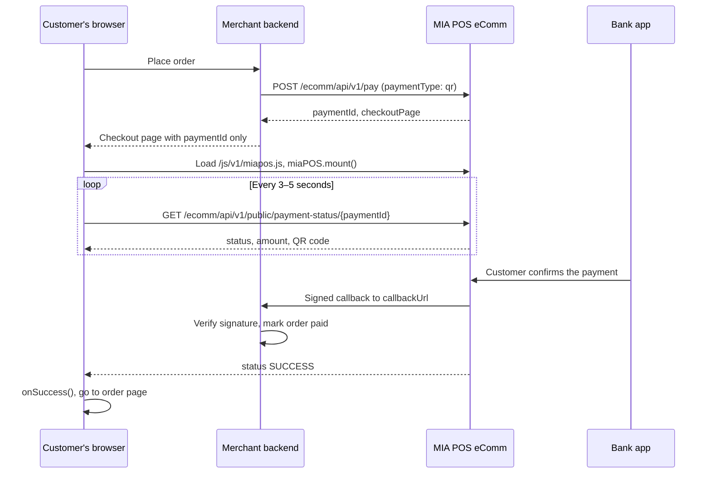

# MIA POS eComm Embedded Checkout (JavaScript Widget)

This document explains how to accept a **MIA POS eComm** payment directly on your own checkout page, without redirecting the customer to the hosted `checkoutPage`. It extends the [Protocol Overview](./protocol-overview.md): the server-side part of the integration stays the same, only the step where the customer pays changes.

> **Status: preview.** The embedded checkout is not yet available in the test or production environments. This guide describes widget version `0.1.0`, which is being prepared for release. Do not add it to a live shop until the bank or the MIA POS team confirms that it is enabled in your environment.

---

## Additional Documentation

- [Protocol Overview](./protocol-overview.md)
- [Signature Verification Guide](./signature-verification.md)
- [API Documentation (download and open in browser)](../mia-ecomm-api_v0.1.1.html)

---

## Hosted or Embedded Checkout

| | Hosted checkout (`checkoutPage`) | Embedded checkout (widget) |
| --- | --- | --- |
| Where the customer pays | On the MIA POS page, after a redirect | On your page, in a block you place there |
| Frontend work | None | One script and a few lines of JavaScript |
| After the payment | MIA POS redirects to `successUrl` / `failUrl` | Your page decides what to do (`onSuccess` / `onFail`) |
| Payment types | `qr` and `rtp` | `qr` only |
| Ready-made plugins (WooCommerce, OpenCart, CS-Cart) | Yes | Not yet |

Both options use the same API, the same terminal and the same signed callback. You can choose between them for each order.

---

## How It Works



1. Your backend registers the payment exactly as for the hosted checkout (`POST /ecomm/api/v1/pay`) and receives `paymentId`.
2. Your backend passes only `paymentId` to the checkout page.
3. The page loads `miapos.js` from your eComm base URL and calls `miaPOS.mount()` with `paymentId`.
4. The widget requests the payment status. The first request for a new payment generates the QR code, the same as when a customer opens `checkoutPage`.
5. The customer pays in the bank app: on a computer by scanning the QR code, on a phone by choosing the bank and opening its app.
6. MIA POS sends the signed result to your `callbackUrl`. Your backend verifies the signature and updates the order.
7. The widget receives the final status, shows the result and calls `onSuccess` or `onFail`. Your page then takes the customer further, for example to the order page.

> **Important:** the order is confirmed by your backend, through the signed callback or `GET /ecomm/api/v1/payment/{paymentId}`, never by the browser. `onSuccess` only tells the page that it can move on.

---

## Step 1. Register the Payment on Your Backend

Follow steps 1–3.3 of the [Protocol Overview](./protocol-overview.md): obtain an access token, then call `POST /ecomm/api/v1/pay`. For the embedded checkout:

- **`paymentType`**: `qr`, or omit the field (`qr` is the default). Request to Pay (`rtp`) payments are not supported by the widget. If you show the widget for an `rtp` payment, it reports no error: the first status request sends the payment request to the customer's phone, and the widget shows an empty placeholder instead of the QR code until `TIMEOUT`.
- **`callbackUrl`**: keep it (or the URL set in the merchant portal). This is how your backend learns the result.
- **`successUrl` / `failUrl`**: the widget does not use them. They still apply if you send the customer to `checkoutPage`.
- **`directRedirect`**: applies to the hosted page only. The widget has its own option with the same name (see the [JavaScript API](#javascript-api)).
- **`language`**: applies to the hosted page only. The widget language is set by the `locale` option.

Save `paymentId` and `checkoutPage` with the order.

Example with the [PHP SDK](https://github.com/miapos/mia-pay-ecomm-php-sdk):

```php
use Finergy\MiaPosSdk\MiaPosSdk;

$sdk = MiaPosSdk::getInstance($baseUrl, $merchantId, $secretKey);

$response = $sdk->createPayment([
    'terminalId'     => 'TE0001',
    'orderId'        => 'order12345',
    'amount'         => 150.75,
    'currency'       => 'MDL',
    'payDescription' => 'Payment for order #12345',
    'callbackUrl'    => 'https://shop.example/miapos/callback',
]);

$paymentId    = $response['paymentId'];    // goes to the checkout page
$checkoutPage = $response['checkoutPage']; // fallback if the widget cannot load
```

> **Important:** never send `merchantId`, `secretKey` or the access token to the browser. The page needs only `paymentId`.

---

## Step 2. Add the Widget to the Checkout Page

```html
<div id="mia-pay"></div>

<script src="https://ecomm-test.miapos.md/js/v1/miapos.js"></script>
<script>
  var paymentId = <?= json_encode($paymentId) ?>;
  var checkoutPage = <?= json_encode($checkoutPage) ?>;

  if (!window.miaPOS) {
    // The script did not load (network error, blocker): use the hosted checkout
    window.location.href = checkoutPage;
  } else {
    var widget = miaPOS.mount('#mia-pay', {
      paymentId: paymentId,
      locale: 'ro',
      onSuccess: function () {
        window.location.href = '/order/12345';
      },
      onFail: function (error) {
        // error.reason: FAILED, DECLINED, EXPIRED or TIMEOUT
        window.location.href = '/order/12345';
      }
    });
  }
</script>
```

- Load the script from the same eComm base URL you use for the API. For the test environment it is `https://ecomm-test.miapos.md`; for production, use the address you received from the bank.
- Load the file as a regular script (`<script src>`), as above. The widget sends its requests to the host it was loaded from, so `baseUrl` is not needed. Do not copy the file into your own JavaScript bundle and do not load it with `type="module"`: in these cases the widget cannot determine the eComm URL, and inside a bundle it does not create `window.miaPOS`.
- Call `mount` after the target element exists: place the script below the element, as above, or call it after `DOMContentLoaded`.
- The order page (`/order/12345` in the example) should show the order status from your backend. It should not rely on how the customer got there.

---

## JavaScript API

### `miaPOS.mount(target, options)`

| Parameter | Type | Required | Description |
| --- | --- | --- | --- |
| `target` | string or `Element` | Yes | CSS selector or DOM element in which the widget is shown |
| `options.paymentId` | string (UUID) | Yes | `paymentId` returned by `POST /ecomm/api/v1/pay`, unchanged. A malformed value is not rejected: the widget keeps waiting and ends with `TIMEOUT` |
| `options.onSuccess` | `function()` | No | Called once when the payment status becomes `SUCCESS` |
| `options.onFail` | `function(error)` | No | Called once when the payment ends without success. `error.reason` is one of the values below |
| `options.locale` | `ro`, `ru`, `en` | No | Widget language. Default: the browser language if it is one of these three, otherwise `ro` |
| `options.directRedirect` | boolean | No | On phones and tablets, open the list of banks automatically as soon as the QR code is ready, so the customer does not have to tap the button. Default: `false` |
| `options.baseUrl` | string | No | eComm base URL. Needed only if the script is not loaded with a regular `<script src>` from the eComm host |

`mount` returns an object with the `destroy()` method. It removes the widget and stops the status requests.

`mount` throws an error if the target element is not found or `paymentId` is missing.

Errors thrown inside your `onSuccess` and `onFail` functions do not appear in the browser console. Wrap your code in `try`/`catch` if you need to see them.

`miaPOS.version` contains the widget version (`0.1.0`).

### Values of `error.reason`

| Value | Meaning | What to do |
| --- | --- | --- |
| `FAILED` | The payment failed | Offer to pay again with a new payment |
| `DECLINED` | The payment was declined | Offer to pay again with a new payment |
| `EXPIRED` | The payment expired, or `paymentId` was not found | Register a new payment |
| `TIMEOUT` | No final status within 15 minutes after `mount` | First check the status on your backend with `GET /ecomm/api/v1/payment/{paymentId}`: the customer may have paid at the last moment. Register a new payment only if it was not paid. The widget itself shows "Waiting timed out. Please create the payment again.", so replace it with your own message once you know the status |

---

## What the Customer Sees

- **Computer:** the amount, the QR code, the hint "Scan the QR code with your bank app" and a waiting indicator.
- **Phone or tablet** (touch screen): the same QR code and a **Choose bank** button. The button opens, over the whole page, the list of banks participating in MIA, taken from the National Bank of Moldova (NBM) list. Tapping a bank opens the payment in that bank's app. Bank links open in a new tab; when the customer returns to your tab, the widget checks the status again.
- **After the payment:** a check mark, "Paid!" and the amount. If the payment did not succeed, the reason and a suggestion to create the payment again.

The widget is drawn in its own Shadow DOM: the styles of your page do not affect it, and its styles do not affect your page. The widget is up to 360 px wide. Its appearance cannot be changed in version `0.1.0`.

---

## Status Checks

- The first request is sent immediately, the next one after 3 seconds, then gradually less often, up to once every 5 seconds.
- While the browser tab is hidden, the widget usually stops the requests and checks the status again when the tab becomes visible.
- Requests stop at a final status (`SUCCESS`, `FAILED`, `DECLINED`, `EXPIRED`) or with `TIMEOUT` 15 minutes after `mount`. The 15 minutes include the time the tab was hidden: if the customer returns later, the widget shows `TIMEOUT` at once, without another request. Reloading the page starts the count again.
- If the server responds with `429`, the widget waits for the time given in `Retry-After`, but at least 5 seconds.
- A network error does not stop the widget: it repeats the request.

The QR code lifetime is set in the terminal settings, the same as for the hosted checkout.

---

## Public Endpoints Used by the Widget

The widget calls two endpoints that do not require authentication. You do not need to call them yourself. They are listed here for your Content Security Policy, firewall rules and debugging.

### `GET /ecomm/api/v1/public/payment-status/{paymentId}`

Response `200`:

```json
{
  "paymentId": "472e651e-5a1e-424d-8098-23858bf03ad7",
  "status": "PENDING",
  "amount": 150.75,
  "currency": "MDL",
  "qrImage": "<QR code image, PNG in base64>",
  "qrText": "<QR code content>"
}
```

| Field | Description |
| --- | --- |
| `paymentId` | Payment identifier |
| `status` | `PENDING`, `SUCCESS`, `FAILED`, `DECLINED` or `EXPIRED`. A payment that has just been registered is returned as `PENDING` |
| `amount`, `currency` | Amount and currency registered by your backend |
| `qrImage` | QR code image (PNG, base64). Returned only while the status is `PENDING` |
| `qrText` | QR code content, used to build the links to bank apps. Returned only while the status is `PENDING` |
| `expiresAt` | Payment deadline. Not returned for QR payments |

- The response contains no payer data: no name, phone number or email.
- The first request for a newly registered payment generates the QR code.
- An unknown `paymentId` returns `404` with an empty body.
- `Cache-Control: no-store` while the payment is in progress; `max-age=60, private` for final statuses.

### `GET /ecomm/api/v1/public/banks`

The list of banks participating in MIA, with links to their apps and logos. MIA POS takes it from the National Bank of Moldova (`https://mia-qr.bnm.md/members.json`) and keeps it for one hour. The widget requests it only on phones and tablets, when the customer opens the list of banks.

---

## Security

1. **The amount is fixed on your server.** The browser receives only `paymentId`. The amount is set by your backend in `POST /ecomm/api/v1/pay` and cannot be changed from the page.
2. **No secrets in the browser.** `merchantId`, `secretKey` and access tokens stay on your backend.
3. **The backend confirms the order.** Mark the order as paid only after a valid signed callback (see the [Signature Verification Guide](./signature-verification.md)) or after `GET /ecomm/api/v1/payment/{paymentId}` with your token. The browser is under the customer's control: anyone can trigger `onSuccess` from the browser console.
4. **Treat `paymentId` the same way as the `checkoutPage` link.** Whoever has it can see the payment status, the amount and the QR code, and can open the MIA POS payment page, which shows your shop name and address, the order number and the payment description (for `rtp` payments, also the customer's name and phone number). Do not send it to analytics systems or public logs.
5. **Content Security Policy.** If your page uses CSP, allow:
   - `script-src` and `connect-src`: your eComm base URL;
   - `img-src`: `data:` (QR code image) and `https://mia-qr.bnm.md` (bank logos);
   - `style-src`: `'unsafe-inline'` (in version `0.1.0` the widget adds its styles inline);
   - your own inline scripts, such as the one in the example above, need a `nonce` or a hash as usual.
6. **Do not pin the file with an `integrity` hash.** The file at `/js/v1/miapos.js` is replaced at the same address when the widget is updated, and an `integrity` hash would then block it.

---

## Single-Page Applications

Call `destroy()` when the customer leaves the checkout screen or before you show the widget for another payment. A second `mount` on the same element adds a second widget instead of replacing the first one.

React example. The handlers are kept in a ref, so the widget always calls the latest ones and is created again only when `paymentId` changes:

```jsx
function MiaPayWidget({ paymentId, onPaid, onFailed }) {
  const ref = React.useRef(null);
  const handlers = React.useRef({ onPaid, onFailed });

  React.useEffect(() => {
    handlers.current = { onPaid, onFailed };
  });

  React.useEffect(() => {
    const widget = window.miaPOS.mount(ref.current, {
      paymentId,
      onSuccess: () => handlers.current.onPaid(),
      onFail: (error) => handlers.current.onFailed(error),
    });
    return () => widget.destroy();
  }, [paymentId]);

  return <div ref={ref} />;
}
```

---

## Testing

- Test environment: `https://ecomm-test.miapos.md`, with test credentials received from the bank.
- Before going live, check that:
  - the order is marked as paid by the callback or by `GET /ecomm/api/v1/payment/{paymentId}`, not by `onSuccess`;
  - the payment works on a phone: the **Choose bank** button, the list of banks and the return to your page;
  - after `TIMEOUT` your page checks the status on your backend before offering a new payment;
  - your CSP allows the widget (no errors in the browser console);
  - the customer is sent to `checkoutPage` if the script does not load.

---

## Limitations of Version 0.1.0

- QR payments only. Request to Pay (`paymentType: rtp`) is not supported.
- Widget languages: Romanian, Russian, English.
- The appearance of the widget cannot be changed.
- If the list of banks cannot be loaded, it opens empty. On a phone the customer can then pay only by scanning the QR code from another device.
- On iPad, links to bank apps may not open, because iPadOS identifies itself as a Mac. The customer can scan the QR code with a phone.
- The ready-made plugins (WooCommerce, OpenCart, CS-Cart) use the hosted checkout.
