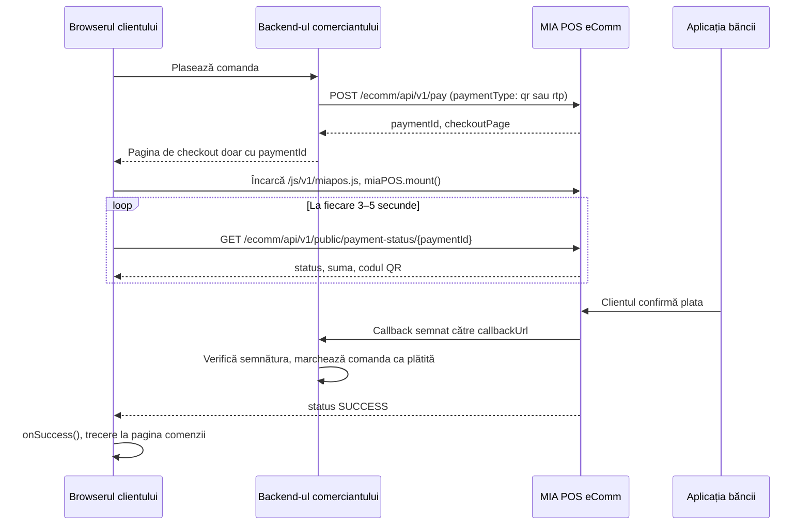

# MIA POS eComm: plata pe pagina magazinului (widget JavaScript)

Acest document explică cum poate fi acceptată o plată **MIA POS eComm** direct pe pagina de checkout a magazinului, fără redirecționarea clientului către pagina `checkoutPage` a MIA POS. Documentul completează [Prezentarea generală a protocolului](./protocol-overview.md): partea de backend a integrării rămâne aceeași, se schimbă doar pasul în care clientul plătește.

> **Status: versiune preliminară.** Widgetul nu este încă disponibil în mediul de test și nici în producție. Ghidul descrie versiunea `0.2.0` a widgetului, care este în pregătire pentru lansare. Nu îl adăugați într-un magazin aflat în funcțiune până când banca sau echipa MIA POS nu confirmă că este activat în mediul dumneavoastră.

---

## Documentație suplimentară

- [Prezentare generală a protocolului](./protocol-overview.md)
- [Ghid de verificare a semnăturii](./signature-verification.md)
- [Documentația API (descărcați și deschideți în browser)](../mia-ecomm-api_v0.1.1.html)

---

## Pagina MIA POS sau widgetul pe pagina magazinului

| | Pagina de plată MIA POS (`checkoutPage`) | Widgetul pe pagina magazinului |
| --- | --- | --- |
| Unde plătește clientul | Pe pagina MIA POS, după redirecționare | Pe pagina magazinului, în blocul pe care îl plasați acolo |
| Lucru pe partea de frontend | Nu este necesar | Un script și câteva rânduri de JavaScript |
| După plată | MIA POS redirecționează către `successUrl` / `failUrl` | Pagina magazinului decide ce urmează (`onSuccess` / `onFail`) |
| Tipuri de plată | `qr` și `rtp` | `qr` și `rtp` |
| Module gata făcute (WooCommerce, OpenCart, CS-Cart) | Da | Încă nu |

Ambele variante folosesc același API, același terminal și același callback semnat. Varianta poate fi aleasă pentru fiecare comandă în parte.

---

## Cum funcționează



1. Backend-ul comerciantului înregistrează plata la fel ca pentru pagina MIA POS (`POST /ecomm/api/v1/pay`) și primește `paymentId`.
2. Backend-ul transmite paginii de checkout doar `paymentId`.
3. Pagina încarcă `miapos.js` de la URL-ul de bază eComm și apelează `miaPOS.mount()` cu `paymentId`.
4. Widgetul solicită statusul plății. Prima solicitare pentru o plată nouă generează codul QR (pentru `rtp` trimite cererea de plată în aplicația băncii clientului), la fel ca la deschiderea paginii `checkoutPage`.
5. Clientul plătește în aplicația băncii: pe calculator scanează codul QR, pe telefon alege banca și deschide aplicația ei. Pentru `rtp` clientul confirmă cererea primită în aplicația băncii.
6. MIA POS trimite rezultatul semnat la `callbackUrl`. Backend-ul verifică semnătura și actualizează comanda.
7. Widgetul primește statusul final, afișează rezultatul și apelează `onSuccess` sau `onFail`. Pagina duce clientul mai departe, de exemplu la pagina comenzii.

> **Important:** comanda este confirmată de backend-ul comerciantului, prin callback-ul semnat sau prin `GET /ecomm/api/v1/payment/{paymentId}`, niciodată de browser. `onSuccess` doar anunță pagina că poate merge mai departe.

---

## Pasul 1. Înregistrarea plății pe backend

Urmați pașii 1–3.3 din [Prezentarea generală a protocolului](./protocol-overview.md): obțineți token-ul de acces, apoi apelați `POST /ecomm/api/v1/pay`. Pentru widget:

- **`paymentType`**: `qr` (valoarea implicită, câmpul poate lipsi) sau `rtp`. Pentru `rtp` completați cererea la fel ca pentru pagina MIA POS. Prima solicitare de status trimite cererea de plată în aplicația băncii clientului, iar widgetul, în locul codului QR, îi cere clientului să o confirme acolo.
- **`callbackUrl`**: păstrați-l (sau adresa setată în portalul comerciantului). Prin el backend-ul află rezultatul plății.
- **`successUrl` / `failUrl`**: widgetul nu le folosește. Rămân valabile dacă trimiteți clientul la `checkoutPage`.
- **`directRedirect`**: se aplică doar paginii MIA POS. Widgetul are propria opțiune cu același nume (consultați [API-ul JavaScript](#api-ul-javascript)).
- **`language`**: se aplică doar paginii MIA POS. Limba widgetului se setează prin opțiunea `locale`.

Salvați `paymentId` și `checkoutPage` împreună cu comanda.

Exemplu cu [PHP SDK](https://github.com/miapos/mia-pay-ecomm-php-sdk):

```php
use Finergy\MiaPosSdk\MiaPosSdk;

$sdk = MiaPosSdk::getInstance($baseUrl, $merchantId, $secretKey);

$response = $sdk->createPayment([
    'terminalId'     => 'TE0001',
    'orderId'        => 'order12345',
    'amount'         => 150.75,
    'currency'       => 'MDL',
    'payDescription' => 'Plata pentru comanda #12345',
    'callbackUrl'    => 'https://shop.example/miapos/callback',
]);

$paymentId    = $response['paymentId'];    // se transmite paginii de checkout
$checkoutPage = $response['checkoutPage']; // variantă de rezervă, dacă widgetul nu se încarcă
```

> **Important:** nu transmiteți niciodată în browser `merchantId`, `secretKey` sau token-ul de acces. Pagina are nevoie doar de `paymentId`.

---

## Pasul 2. Adăugarea widgetului pe pagina de checkout

```html
<div id="mia-pay"></div>

<script src="https://ecomm-test.miapos.md/js/v1/miapos.js"></script>
<script>
  var paymentId = <?= json_encode($paymentId) ?>;
  var checkoutPage = <?= json_encode($checkoutPage) ?>;

  if (!window.miaPOS) {
    // Scriptul nu s-a încărcat (eroare de rețea, blocare) sau browserul este prea vechi
    // pentru widget: folosim pagina MIA POS
    window.location.href = checkoutPage;
  } else {
    var widget = miaPOS.mount('#mia-pay', {
      paymentId: paymentId,
      locale: 'ro',
      onSuccess: function () {
        window.location.href = '/order/12345';
      },
      onFail: function (error) {
        // error.reason: FAILED, DECLINED, EXPIRED sau TIMEOUT
        window.location.href = '/order/12345';
      }
    });
  }
</script>
```

- Încărcați scriptul de la același URL de bază eComm pe care îl folosiți pentru API. În mediul de test aceasta este `https://ecomm-test.miapos.md`; în producție folosiți adresa primită de la bancă.
- Încărcați fișierul ca script obișnuit (`<script src>`), ca în exemplu. Widgetul trimite solicitările la adresa de la care a fost încărcat, așa că `baseUrl` nu este necesar. Dacă copiați fișierul în propriul bundle JavaScript, îl publicați pe serverul magazinului sau îl încărcați cu `type="module"`, widgetul nu poate determina URL-ul eComm: transmiteți `baseUrl`, altfel `mount` aruncă o eroare. O copie nu se actualizează odată cu serverul, de aceea recomandăm scriptul obișnuit.
- Apelați `mount` după ce elementul țintă există: plasați scriptul sub element, ca în exemplu, sau apelați `mount` după `DOMContentLoaded`.
- Pagina comenzii (`/order/12345` în exemplu) trebuie să afișeze statusul comenzii din backend, indiferent de modul în care a ajuns clientul pe ea.

---

## API-ul JavaScript

### `miaPOS.mount(target, options)`

| Parametru | Tip | Obligatoriu | Descriere |
| --- | --- | --- | --- |
| `target` | șir de caractere sau `Element` | Da | Selector CSS sau element DOM în care se afișează widgetul |
| `options.paymentId` | șir de caractere (UUID) | Da | `paymentId` primit de la `POST /ecomm/api/v1/pay`, fără modificări. O valoare care nu este UUID încheie imediat widgetul cu `EXPIRED` |
| `options.onSuccess` | `function()` | Nu | Se apelează o singură dată, când statusul plății devine `SUCCESS` |
| `options.onFail` | `function(error)` | Nu | Se apelează o singură dată, când plata se încheie fără succes. `error.reason` ia una dintre valorile de mai jos |
| `options.locale` | `ro`, `ru`, `en` | Nu | Limba widgetului. Implicit: limba browserului, dacă este una dintre cele trei, altfel `ro` |
| `options.directRedirect` | boolean | Nu | Pe telefoane și tablete, deschide automat lista băncilor imediat ce codul QR este gata, ca clientul să nu mai apese butonul. Nu se aplică pentru `rtp`. Implicit: `false` |
| `options.baseUrl` | șir de caractere | Nu | URL-ul de bază eComm. Obligatoriu dacă scriptul nu este încărcat ca script obișnuit (`<script src>`) de la serverul eComm |

`mount` întoarce un obiect cu metoda `destroy()`. Aceasta elimină widgetul și oprește solicitările de status.

`mount` aruncă o eroare dacă elementul țintă nu este găsit, lipsește `paymentId` sau URL-ul eComm nu poate fi determinat (consultați `baseUrl`).

Un al doilea `mount` pe același element înlocuiește primul widget: primul este eliminat și își oprește solicitările. Dacă al doilea `mount` aruncă o eroare, primul widget continuă să funcționeze.

O eroare apărută în `onSuccess` sau `onFail` nu oprește widgetul. Ea este scrisă în consola browserului ca `[miaPOS] callback threw`.

`miaPOS.version` conține versiunea widgetului (`0.2.0`).

### Valorile `error.reason`

| Valoare | Ce înseamnă | Ce faceți |
| --- | --- | --- |
| `FAILED` | Plata nu a reușit | Propuneți o nouă încercare cu o plată nouă |
| `DECLINED` | Plata a fost respinsă | Propuneți o nouă încercare cu o plată nouă |
| `EXPIRED` | Plata a expirat, serverul nu cunoaște acest `paymentId` (două răspunsuri la rând) sau `paymentId` nu este UUID | Înregistrați o plată nouă |
| `TIMEOUT` | Statusul final nu a fost primit în 15 minute de la `mount`; pentru `rtp`, în 30 de secunde după expirarea cererii de plată, dacă aceasta vine mai devreme. Înainte de `TIMEOUT` widgetul mai solicită o dată statusul | Mai întâi verificați statusul pe backend prin `GET /ecomm/api/v1/payment/{paymentId}`: clientul poate să fi plătit în ultimul moment. Înregistrați o plată nouă doar dacă plata nu a fost efectuată. Widgetul afișează „Nu am primit confirmarea plății. Dacă ați plătit deja, nu repetați plata. Magazinul va verifica starea comenzii.” |

---

## Ce vede clientul

- **Calculator:** suma, codul QR, indicația „Scanați codul QR cu aplicația băncii” și un indicator de așteptare.
- **Telefon sau tabletă** (ecran tactil): același cod QR și butonul **Alegeți banca**. Butonul deschide, peste întreaga pagină, lista băncilor participante la MIA, preluată din lista Băncii Naționale a Moldovei (BNM). La atingerea unei bănci, plata se deschide în aplicația acelei bănci. Linkurile către bănci se deschid într-o filă nouă; când clientul revine în fila magazinului, widgetul verifică din nou statusul. Lista se închide cu butonul ✕, cu o atingere în afara ei sau cu tasta Esc. Dacă lista nu poate fi încărcată, widgetul afișează „Lista băncilor nu este disponibilă acum. Scanați codul QR cu aplicația băncii.”
- **Plată `rtp`:** suma, „Confirmați plata în aplicația băncii”, „Am trimis cererea de plată în aplicația băncii dvs.” și un indicator de așteptare. Nu există cod QR și nici lista băncilor.
- **După plată:** o bifă, „Plătit!” și suma. Dacă plata nu a reușit, motivul și „Încercați să plătiți din nou.” După `TIMEOUT`, textul din tabelul de mai sus.

Sumele sunt afișate în formatul limbii widgetului. Widgetul este afișat în propriul Shadow DOM: stilurile paginii nu îl influențează, iar stilurile lui nu influențează pagina. Lățimea widgetului este de cel mult 360 px. Aspectul nu poate fi modificat în versiunea `0.2.0`.

---

## Verificarea statusului

- Prima solicitare se trimite imediat, următoarele după 3 și 4 secunde, apoi o dată la 5 secunde.
- Cât timp fila browserului este ascunsă, widgetul nu trimite solicitări. Când fila devine vizibilă, verifică imediat statusul. Un widget afișat într-o filă din fundal trimite prima solicitare, cea care creează codul QR, abia când clientul deschide fila.
- Solicitările se încheie la un status final (`SUCCESS`, `FAILED`, `DECLINED`, `EXPIRED`) sau la limita de așteptare: 15 minute după `mount` sau, pentru `rtp`, 30 de secunde după expirarea cererii de plată, oricare vine mai întâi. Durata cererii se calculează după ceasul serverului, așa că un ceas greșit pe telefonul clientului nu contează. Cele 15 minute includ și timpul în care fila a fost ascunsă. La atingerea limitei, widgetul mai solicită o dată statusul (până la trei încercări la 5 secunde, dacă nu primește răspuns) și abia apoi raportează `TIMEOUT`. Reîncărcarea paginii pornește numărătoarea din nou.
- Dacă serverul răspunde cu `429`, widgetul așteaptă timpul indicat în `Retry-After`, dar cel puțin 5 secunde, chiar dacă între timp fila a fost ascunsă și afișată din nou.
- O eroare de rețea sau de server nu oprește widgetul: acesta repetă solicitarea și păstrează pe ecran ce afișa înainte.
- Un singur `404` este ignorat; două răspunsuri `404` la rând încheie widgetul cu `EXPIRED`. Un `400` (`paymentId` nu este UUID) îl încheie imediat.

Durata de valabilitate a codului QR este stabilită în setările terminalului, la fel ca pentru pagina MIA POS.

---

## Endpoint-uri publice folosite de widget

Widgetul apelează două endpoint-uri care nu cer autentificare. Nu este nevoie să le apelați dumneavoastră. Sunt descrise aici pentru Content Security Policy, regulile firewall-ului și depanare.

### `GET /ecomm/api/v1/public/payment-status/{paymentId}`

Răspuns `200`:

```json
{
  "paymentId": "472e651e-5a1e-424d-8098-23858bf03ad7",
  "status": "PENDING",
  "paymentType": "QR",
  "amount": 150.75,
  "currency": "MDL",
  "qrImage": "<imaginea codului QR, PNG în base64>",
  "qrText": "<conținutul codului QR>"
}
```

| Câmp | Descriere |
| --- | --- |
| `paymentId` | Identificatorul plății |
| `status` | `PENDING`, `SUCCESS`, `FAILED`, `DECLINED` sau `EXPIRED`. O plată abia înregistrată este returnată ca `PENDING` |
| `paymentType` | `QR` sau `RTP` |
| `amount`, `currency` | Suma și moneda înregistrate de backend |
| `qrImage` | Imaginea codului QR (PNG, base64). Doar pentru `QR`, cât timp statusul este `PENDING` |
| `qrText` | Conținutul codului QR, folosit pentru linkurile către aplicațiile băncilor. Doar pentru `QR`, cât timp statusul este `PENDING` |
| `expiresAt` | Termenul cererii de plată, ISO 8601 cu decalajul fusului orar al serverului, de exemplu `2026-10-24T17:40:06+03:00`. Doar pentru `RTP`, cât timp statusul este `PENDING` |
| `expiresInSeconds` | Secundele rămase până la `expiresAt`, calculate după ceasul serverului. Doar pentru `RTP`, cât timp statusul este `PENDING` |

- Răspunsul nu conține date ale plătitorului: nici nume, nici număr de telefon, nici email.
- Prima solicitare pentru o plată abia înregistrată generează codul QR sau, pentru `rtp`, trimite cererea de plată.
- Pentru un `paymentId` care nu este UUID se returnează `400`. Pentru un `paymentId` necunoscut se returnează `404` cu corp gol.
- Prea multe solicitări primesc `429` cu antetul `Retry-After`, în secunde. Limitele implicite sunt 60 de solicitări pe minut pentru o plată și 600 de solicitări pe minut de la o adresă IP; banca poate seta alte valori. Widgetul rămâne mult sub ele.
- `Cache-Control: no-store` cât timp plata este în curs; `max-age=60, private` pentru statusurile finale.

### `GET /ecomm/api/v1/public/banks`

Lista băncilor participante la MIA, cu linkuri către aplicațiile lor și logouri. MIA POS o preia de la Banca Națională a Moldovei (`https://mia-qr.bnm.md/members.json`) și o păstrează o oră. Se transmit doar denumirea băncii, logoul și linkurile către aplicații; o bancă ale cărei linkuri nu încep cu `https://` sau `intent://` este omisă. Dacă site-ul BNM nu este accesibil, se returnează ultima listă primită; dacă încă nu există niciuna, endpoint-ul răspunde cu `502`. Widgetul solicită lista doar pe telefoane și tablete, când clientul deschide lista băncilor.

---

## Securitate

1. **Suma se stabilește pe serverul comerciantului.** Browserul primește doar `paymentId`. Suma este setată de backend în `POST /ecomm/api/v1/pay` și nu poate fi modificată din pagină.
2. **Fără secrete în browser.** `merchantId`, `secretKey` și token-urile de acces rămân pe backend.
3. **Comanda o confirmă backend-ul.** Marcați comanda ca plătită doar după un callback semnat valid (consultați [Ghidul de verificare a semnăturii](./signature-verification.md)) sau după `GET /ecomm/api/v1/payment/{paymentId}` cu token-ul dumneavoastră. Browserul este sub controlul clientului: oricine poate declanșa `onSuccess` din consola browserului.
4. **Tratați `paymentId` la fel ca linkul `checkoutPage`.** Cine îl are poate vedea statusul plății, suma și codul QR și poate deschide pagina de plată MIA POS, care afișează denumirea și adresa magazinului, numărul comenzii și descrierea plății (pentru plățile `rtp` — și numele și telefonul clientului). Nu îl trimiteți în sisteme de analiză și nici în jurnale publice.
5. **Content Security Policy.** Dacă pagina folosește CSP, permiteți:
   - `script-src` și `connect-src`: URL-ul de bază eComm;
   - `img-src`: `data:` (imaginea codului QR) și `https://mia-qr.bnm.md` (logourile băncilor);
   - `style-src`: `'unsafe-inline'` (în versiunea `0.2.0` widgetul își adaugă stilurile inline);
   - scripturile inline proprii, ca cel din exemplul de mai sus, au nevoie, ca de obicei, de `nonce` sau de hash.
6. **Nu folosiți atributul `integrity` (SRI) pentru acest fișier.** Fișierul de la `/js/v1/miapos.js` este înlocuit la aceeași adresă când widgetul este actualizat, iar hash-ul din `integrity` l-ar bloca.

---

## Aplicații cu o singură pagină (SPA)

Apelați `destroy()` când clientul părăsește ecranul de checkout. Un al doilea `mount` pe același element înlocuiește primul widget, așa că o randare repetată nu creează două widgeturi și nu apelează `onSuccess` de două ori.

Exemplu React. Funcțiile de răspuns sunt păstrate într-un ref, astfel încât widgetul apelează mereu versiunea lor actuală și este creat din nou doar când se schimbă `paymentId`:

```jsx
function MiaPayWidget({ paymentId, onPaid, onFailed }) {
  const ref = React.useRef(null);
  const handlers = React.useRef({ onPaid, onFailed });

  React.useEffect(() => {
    handlers.current = { onPaid, onFailed };
  });

  React.useEffect(() => {
    const widget = window.miaPOS.mount(ref.current, {
      paymentId,
      onSuccess: () => handlers.current.onPaid(),
      onFail: (error) => handlers.current.onFailed(error),
    });
    return () => widget.destroy();
  }, [paymentId]);

  return <div ref={ref} />;
}
```

---

## Testare

- Mediul de test: `https://ecomm-test.miapos.md`, cu datele de acces de test primite de la bancă.
- Înainte de lansare, verificați că:
  - comanda este marcată ca plătită de callback sau de `GET /ecomm/api/v1/payment/{paymentId}`, nu de `onSuccess`;
  - plata funcționează pe telefon: butonul **Alegeți banca**, lista băncilor și revenirea pe pagina magazinului;
  - dacă folosiți `rtp`: cererea ajunge în aplicația băncii, iar după confirmare widgetul afișează rezultatul;
  - după `TIMEOUT` pagina verifică statusul pe backend înainte de a propune o plată nouă;
  - CSP permite widgetul (fără erori în consola browserului);
  - clientul este trimis la `checkoutPage` dacă scriptul nu se încarcă.

---

## Limitările versiunii 0.2.0

- Limbile widgetului: română, rusă, engleză.
- Aspectul widgetului nu poate fi modificat.
- Un browser fără Shadow DOM, `fetch` sau `Promise` (de exemplu Internet Explorer) nu primește `window.miaPOS`. Verificarea din Pasul 2 trimite atunci clientul la `checkoutPage`.
- Dacă widgetul nu poate accesa deloc serverul eComm (`baseUrl` greșit, solicitarea blocată de CSP), afișează ecranul de încărcare și reîncearcă până la `TIMEOUT`. Verificați consola browserului în timpul testării.
- Dacă lista băncilor nu poate fi încărcată, clientul de pe telefon poate plăti doar scanând codul QR de pe alt dispozitiv.
- Modulele gata făcute (WooCommerce, OpenCart, CS-Cart) folosesc pagina de plată MIA POS.
