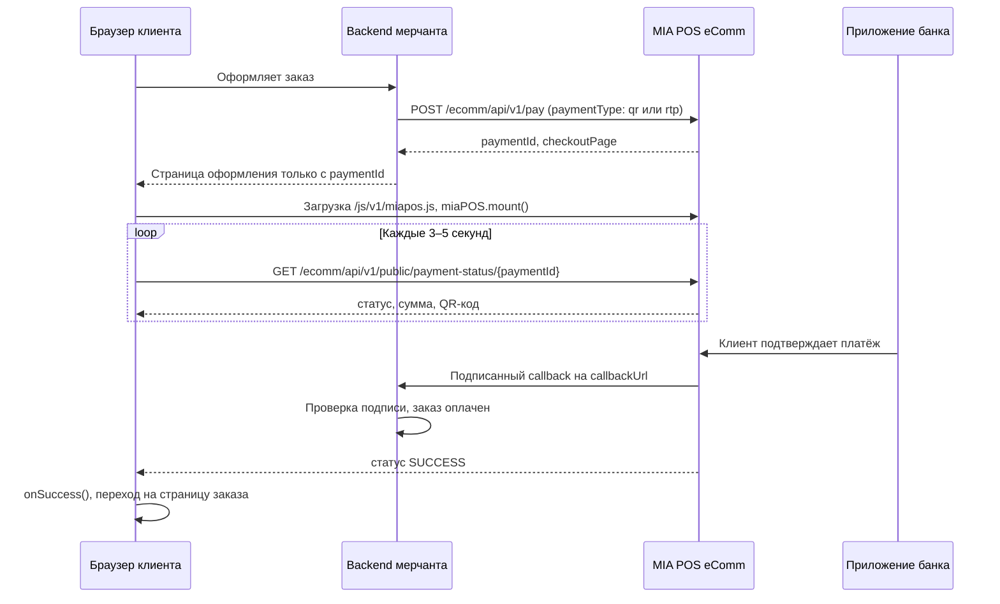

# MIA POS eComm: оплата на странице магазина (JavaScript-виджет)

Этот документ описывает, как принять платёж **MIA POS eComm** прямо на странице оформления заказа магазина, не перенаправляя клиента на страницу `checkoutPage` MIA POS. Документ дополняет [Общее описание протокола](./protocol-overview.md): серверная часть интеграции остаётся прежней, меняется только шаг, на котором клиент платит.

> **Статус: предварительная версия.** Виджет пока недоступен ни в тестовой среде, ни в продакшене. Документ описывает версию виджета `0.2.0`, которая готовится к выпуску. Не добавляйте его в работающий магазин, пока банк или команда MIA POS не подтвердит, что он включён в вашей среде.

---

## Дополнительная документация

- [Общее описание протокола](./protocol-overview.md)
- [Инструкция по проверке подписи](./signature-verification.md)
- [Документация API (скачайте и откройте в браузере)](../mia-ecomm-api_v0.1.1.html)

---

## Страница MIA POS или виджет на странице магазина

| | Страница оплаты MIA POS (`checkoutPage`) | Виджет на странице магазина |
| --- | --- | --- |
| Где платит клиент | На странице MIA POS, после перенаправления | На странице магазина, в блоке, который вы там размещаете |
| Доработка frontend | Не нужна | Один скрипт и несколько строк JavaScript |
| После оплаты | MIA POS перенаправляет на `successUrl` / `failUrl` | Страница магазина сама решает, что дальше (`onSuccess` / `onFail`) |
| Типы оплаты | `qr` и `rtp` | `qr` и `rtp` |
| Готовые модули (WooCommerce, OpenCart, CS-Cart) | Есть | Пока нет |

Оба варианта используют один и тот же API, тот же терминал и тот же подписанный callback. Вариант можно выбирать для каждого заказа отдельно.

---

## Как это работает



1. Backend мерчанта регистрирует платёж так же, как для страницы MIA POS (`POST /ecomm/api/v1/pay`), и получает `paymentId`.
2. Backend передаёт на страницу оформления заказа только `paymentId`.
3. Страница загружает `miapos.js` с базового URL eComm и вызывает `miaPOS.mount()` с `paymentId`.
4. Виджет запрашивает статус платежа. Первый запрос по новому платежу создаёт QR-код (для `rtp` — отправляет запрос на оплату в приложение банка клиента), так же, как при открытии `checkoutPage`.
5. Клиент платит в приложении банка: на компьютере сканирует QR-код, на телефоне выбирает банк и открывает его приложение. Для `rtp` клиент подтверждает запрос, пришедший в приложение банка.
6. MIA POS отправляет подписанный результат на `callbackUrl`. Backend проверяет подпись и обновляет заказ.
7. Виджет получает итоговый статус, показывает результат и вызывает `onSuccess` или `onFail`. Страница ведёт клиента дальше, например на страницу заказа.

> **Важно:** заказ подтверждает backend мерчанта — по подписанному callback или через `GET /ecomm/api/v1/payment/{paymentId}`, но никогда не браузер. `onSuccess` только сообщает странице, что можно идти дальше.

---

## Шаг 1. Регистрация платежа на backend

Выполните шаги 1–3.3 из [Общего описания протокола](./protocol-overview.md): получите access token, затем вызовите `POST /ecomm/api/v1/pay`. Для виджета:

- **`paymentType`**: `qr` (значение по умолчанию, поле можно не передавать) или `rtp`. Для `rtp` заполните запрос так же, как для страницы MIA POS. Первый запрос статуса отправит запрос на оплату в приложение банка клиента, и вместо QR-кода виджет попросит клиента подтвердить оплату там.
- **`callbackUrl`**: оставьте (или адрес, заданный в портале мерчанта). Через него backend узнаёт результат платежа.
- **`successUrl` / `failUrl`**: виджет их не использует. Они продолжают работать, если вы отправите клиента на `checkoutPage`.
- **`directRedirect`**: действует только на странице MIA POS. У виджета есть своя опция с тем же именем (см. [JavaScript API](#javascript-api)).
- **`language`**: действует только на странице MIA POS. Язык виджета задаётся опцией `locale`.

Сохраните `paymentId` и `checkoutPage` вместе с заказом.

Пример с [PHP SDK](https://github.com/miapos/mia-pay-ecomm-php-sdk):

```php
use Finergy\MiaPosSdk\MiaPosSdk;

$sdk = MiaPosSdk::getInstance($baseUrl, $merchantId, $secretKey);

$response = $sdk->createPayment([
    'terminalId'     => 'TE0001',
    'orderId'        => 'order12345',
    'amount'         => 150.75,
    'currency'       => 'MDL',
    'payDescription' => 'Оплата заказа #12345',
    'callbackUrl'    => 'https://shop.example/miapos/callback',
]);

$paymentId    = $response['paymentId'];    // передаётся на страницу оформления
$checkoutPage = $response['checkoutPage']; // запасной вариант, если виджет не загрузится
```

> **Важно:** никогда не передавайте в браузер `merchantId`, `secretKey` или access token. Странице достаточно `paymentId`.

---

## Шаг 2. Добавление виджета на страницу оформления заказа

```html
<div id="mia-pay"></div>

<script src="https://ecomm-test.miapos.md/js/v1/miapos.js"></script>
<script>
  var paymentId = <?= json_encode($paymentId) ?>;
  var checkoutPage = <?= json_encode($checkoutPage) ?>;

  if (!window.miaPOS) {
    // Скрипт не загрузился (ошибка сети, блокировщик) или браузер слишком старый
    // для виджета: используем страницу MIA POS
    window.location.href = checkoutPage;
  } else {
    var widget = miaPOS.mount('#mia-pay', {
      paymentId: paymentId,
      locale: 'ru',
      onSuccess: function () {
        window.location.href = '/order/12345';
      },
      onFail: function (error) {
        // error.reason: FAILED, DECLINED, EXPIRED или TIMEOUT
        window.location.href = '/order/12345';
      }
    });
  }
</script>
```

- Загружайте скрипт с того же базового URL eComm, который используете для API. В тестовой среде это `https://ecomm-test.miapos.md`; в продакшене — адрес, полученный от банка.
- Подключайте файл обычным скриптом (`<script src>`), как в примере. Виджет отправляет запросы на тот адрес, с которого загружен, поэтому `baseUrl` не нужен. Если вы копируете файл в собственный JavaScript-бандл, раздаёте его со своего сервера или загружаете с `type="module"`, виджет не может определить URL eComm: передайте `baseUrl`, иначе `mount` выбросит ошибку. Копия не обновляется вместе с сервером, поэтому рекомендуем обычный скрипт.
- Вызывайте `mount`, когда целевой элемент уже есть на странице: разместите скрипт под элементом, как в примере, или вызывайте `mount` после `DOMContentLoaded`.
- Страница заказа (`/order/12345` в примере) должна показывать статус заказа из backend и не зависеть от того, как клиент на неё попал.

---

## JavaScript API

### `miaPOS.mount(target, options)`

| Параметр | Тип | Обязательный | Описание |
| --- | --- | --- | --- |
| `target` | строка или `Element` | Да | CSS-селектор или DOM-элемент, в котором показывается виджет |
| `options.paymentId` | строка (UUID) | Да | `paymentId`, полученный от `POST /ecomm/api/v1/pay`, без изменений. Значение, которое не является UUID, сразу завершает виджет с `EXPIRED` |
| `options.onSuccess` | `function()` | Нет | Вызывается один раз, когда статус платежа становится `SUCCESS` |
| `options.onFail` | `function(error)` | Нет | Вызывается один раз, когда платёж завершается неуспешно. `error.reason` — одно из значений ниже |
| `options.locale` | `ro`, `ru`, `en` | Нет | Язык виджета. По умолчанию — язык браузера, если это один из трёх, иначе `ro` |
| `options.directRedirect` | boolean | Нет | На телефонах и планшетах автоматически открывает список банков, как только готов QR-код, чтобы клиенту не нужно было нажимать кнопку. Для `rtp` не действует. По умолчанию `false` |
| `options.baseUrl` | строка | Нет | Базовый URL eComm. Обязателен, если скрипт загружен не обычным `<script src>` с сервера eComm |

`mount` возвращает объект с методом `destroy()`. Метод удаляет виджет и останавливает запросы статуса.

`mount` выбрасывает ошибку, если целевой элемент не найден, не передан `paymentId` или не удаётся определить URL eComm (см. `baseUrl`).

Повторный `mount` на том же элементе заменяет первый виджет: первый удаляется и прекращает запросы. Если повторный `mount` выбросил ошибку, первый виджет продолжает работать.

Исключение внутри ваших `onSuccess` или `onFail` не останавливает виджет. Оно выводится в консоль браузера как `[miaPOS] callback threw`.

`miaPOS.version` — версия виджета (`0.2.0`).

### Значения `error.reason`

| Значение | Что означает | Что делать |
| --- | --- | --- |
| `FAILED` | Платёж не прошёл | Предложить оплатить ещё раз новым платежом |
| `DECLINED` | Платёж отклонён | Предложить оплатить ещё раз новым платежом |
| `EXPIRED` | Срок платежа истёк, сервер не знает этот `paymentId` (два ответа подряд) или `paymentId` не является UUID | Зарегистрировать новый платёж |
| `TIMEOUT` | За 15 минут после `mount` итоговый статус не получен; для `rtp` — за 30 секунд после истечения запроса на оплату, если это наступит раньше. Перед `TIMEOUT` виджет запрашивает статус ещё раз | Сначала проверить статус на backend через `GET /ecomm/api/v1/payment/{paymentId}`: клиент мог оплатить в последний момент. Новый платёж регистрировать, только если оплаты не было. Сам виджет пишет «Мы не получили подтверждение оплаты. Если вы уже оплатили, не платите повторно. Магазин проверит статус заказа.» |

---

## Что видит клиент

- **Компьютер:** сумма, QR-код, подсказка «Отсканируйте QR-код приложением банка» и индикатор ожидания.
- **Телефон или планшет** (сенсорный экран): тот же QR-код и кнопка **Выбрать банк**. Кнопка открывает поверх всей страницы список банков — участников MIA из списка Национального банка Молдовы (НБМ). Нажатие на банк открывает платёж в приложении этого банка. Ссылки на банки открываются в новой вкладке; когда клиент возвращается во вкладку магазина, виджет снова проверяет статус. Список закрывается кнопкой ✕, нажатием вне списка или клавишей Esc. Если список не загрузился, виджет пишет «Список банков сейчас недоступен. Отсканируйте QR-код приложением банка.»
- **Платёж `rtp`:** сумма, «Подтвердите оплату в приложении банка», «Мы отправили запрос на оплату в приложение вашего банка.» и индикатор ожидания. QR-кода и списка банков нет.
- **После оплаты:** галочка, «Оплачено!» и сумма. Если платёж не прошёл — причина и «Попробуйте оплатить ещё раз.» После `TIMEOUT` — текст из таблицы выше.

Суммы показываются в формате языка виджета. Виджет отрисовывается в собственном Shadow DOM: стили страницы на него не влияют, а его стили не влияют на страницу. Ширина виджета — не больше 360 px. Внешний вид в версии `0.2.0` изменить нельзя.

---

## Проверка статуса

- Первый запрос уходит сразу, следующие — через 3 и 4 секунды, затем раз в 5 секунд.
- Пока вкладка браузера скрыта, виджет не делает запросов. Когда вкладка становится видимой, он сразу проверяет статус. Виджет, показанный в фоновой вкладке, отправляет первый запрос — тот, что создаёт QR-код, — только когда клиент откроет вкладку.
- Запросы прекращаются при получении итогового статуса (`SUCCESS`, `FAILED`, `DECLINED`, `EXPIRED`) или по пределу ожидания: через 15 минут после `mount`, а для `rtp` — через 30 секунд после истечения запроса на оплату, смотря что наступит раньше. Срок запроса считается по часам сервера, поэтому неверные часы на телефоне клиента не мешают. В 15 минут входит и время, пока вкладка была скрыта. Достигнув предела, виджет запрашивает статус ещё раз (до трёх попыток с интервалом 5 секунд, если ответа нет) и только потом сообщает `TIMEOUT`. Перезагрузка страницы начинает отсчёт заново.
- Если сервер отвечает `429`, виджет ждёт время из `Retry-After`, но не меньше 5 секунд, даже если за это время вкладку скрыли и снова открыли.
- Ошибка сети или сервера не останавливает виджет: он повторяет запрос и оставляет на экране то, что показывал.
- Одиночный `404` игнорируется; два ответа `404` подряд завершают виджет с `EXPIRED`. Ответ `400` (`paymentId` не является UUID) завершает его сразу.

Срок действия QR-кода задаётся в настройках терминала — так же, как для страницы MIA POS.

---

## Публичные endpoint'ы, которые использует виджет

Виджет вызывает два endpoint'а, не требующих аутентификации. Вызывать их самим не нужно. Они перечислены здесь для Content Security Policy, правил firewall и отладки.

### `GET /ecomm/api/v1/public/payment-status/{paymentId}`

Ответ `200`:

```json
{
  "paymentId": "472e651e-5a1e-424d-8098-23858bf03ad7",
  "status": "PENDING",
  "paymentType": "QR",
  "amount": 150.75,
  "currency": "MDL",
  "qrImage": "<изображение QR-кода, PNG в base64>",
  "qrText": "<содержимое QR-кода>"
}
```

| Поле | Описание |
| --- | --- |
| `paymentId` | Идентификатор платежа |
| `status` | `PENDING`, `SUCCESS`, `FAILED`, `DECLINED` или `EXPIRED`. Только что зарегистрированный платёж возвращается как `PENDING` |
| `paymentType` | `QR` или `RTP` |
| `amount`, `currency` | Сумма и валюта, переданные backend при регистрации платежа |
| `qrImage` | Изображение QR-кода (PNG, base64). Только для `QR`, пока статус `PENDING` |
| `qrText` | Содержимое QR-кода, из него строятся ссылки на приложения банков. Только для `QR`, пока статус `PENDING` |
| `expiresAt` | Срок запроса на оплату, ISO 8601 со смещением часового пояса сервера, например `2026-10-24T17:40:06+03:00`. Только для `RTP`, пока статус `PENDING` |
| `expiresInSeconds` | Сколько секунд осталось до `expiresAt`, по часам сервера. Только для `RTP`, пока статус `PENDING` |

- В ответе нет данных плательщика: ни имени, ни телефона, ни email.
- Первый запрос по только что зарегистрированному платежу создаёт QR-код, а для `rtp` — отправляет запрос на оплату.
- На `paymentId`, который не является UUID, возвращается `400`. На неизвестный `paymentId` — `404` с пустым телом.
- На слишком частые запросы возвращается `429` с заголовком `Retry-After` в секундах. Пределы по умолчанию — 60 запросов в минуту по одному платежу и 600 запросов в минуту с одного IP-адреса; банк может задать другие значения. Виджет держится намного ниже них.
- `Cache-Control: no-store`, пока платёж в процессе; `max-age=60, private` для итоговых статусов.

### `GET /ecomm/api/v1/public/banks`

Список банков — участников MIA со ссылками на их приложения и логотипами. MIA POS берёт его у Национального банка Молдовы (`https://mia-qr.bnm.md/members.json`) и хранит один час. Передаются только название банка, логотип и ссылки на приложения; банк, чьи ссылки начинаются не с `https://` или `intent://`, в список не попадает. Если сайт НБМ недоступен, отдаётся последний полученный список; если его ещё нет, endpoint отвечает `502`. Виджет запрашивает список только на телефонах и планшетах, когда клиент открывает список банков.

---

## Безопасность

1. **Сумма фиксируется на сервере мерчанта.** Браузер получает только `paymentId`. Сумму задаёт backend в `POST /ecomm/api/v1/pay`, со страницы её изменить нельзя.
2. **Никаких секретов в браузере.** `merchantId`, `secretKey` и access token остаются на backend.
3. **Заказ подтверждает backend.** Отмечайте заказ оплаченным только после валидного подписанного callback (см. [Инструкцию по проверке подписи](./signature-verification.md)) или после `GET /ecomm/api/v1/payment/{paymentId}` с вашим токеном. Браузер в руках клиента: вызвать `onSuccess` из консоли браузера может кто угодно.
4. **Обращайтесь с `paymentId` так же, как со ссылкой `checkoutPage`.** У кого он есть, тот видит статус платежа, сумму и QR-код и может открыть страницу оплаты MIA POS, где видны название и адрес магазина, номер заказа и описание платежа (для платежей `rtp` — ещё имя и телефон клиента). Не отправляйте его в системы аналитики и публичные логи.
5. **Content Security Policy.** Если страница использует CSP, разрешите:
   - `script-src` и `connect-src`: базовый URL eComm;
   - `img-src`: `data:` (изображение QR-кода) и `https://mia-qr.bnm.md` (логотипы банков);
   - `style-src`: `'unsafe-inline'` (в версии `0.2.0` виджет добавляет стили inline);
   - вашим собственным inline-скриптам, как в примере выше, как обычно, нужен `nonce` или хэш.
6. **Не задавайте для этого файла атрибут `integrity` (SRI).** Файл `/js/v1/miapos.js` при обновлении виджета заменяется по тому же адресу, и хэш в `integrity` его заблокирует.

---

## Одностраничные приложения (SPA)

Вызывайте `destroy()`, когда клиент уходит с экрана оформления заказа. Повторный `mount` на том же элементе заменяет первый виджет, поэтому повторная отрисовка не создаёт два виджета и не вызывает `onSuccess` дважды.

Пример для React. Обработчики хранятся в ref: виджет всегда вызывает их актуальную версию и создаётся заново, только когда меняется `paymentId`:

```jsx
function MiaPayWidget({ paymentId, onPaid, onFailed }) {
  const ref = React.useRef(null);
  const handlers = React.useRef({ onPaid, onFailed });

  React.useEffect(() => {
    handlers.current = { onPaid, onFailed };
  });

  React.useEffect(() => {
    const widget = window.miaPOS.mount(ref.current, {
      paymentId,
      onSuccess: () => handlers.current.onPaid(),
      onFail: (error) => handlers.current.onFailed(error),
    });
    return () => widget.destroy();
  }, [paymentId]);

  return <div ref={ref} />;
}
```

---

## Тестирование

- Тестовая среда: `https://ecomm-test.miapos.md`, с тестовыми данными доступа от банка.
- Перед запуском проверьте, что:
  - заказ отмечается оплаченным по callback или по `GET /ecomm/api/v1/payment/{paymentId}`, а не по `onSuccess`;
  - оплата работает с телефона: кнопка **Выбрать банк**, список банков и возврат на страницу магазина;
  - если используете `rtp`: запрос приходит в приложение банка, а после подтверждения виджет показывает результат;
  - после `TIMEOUT` страница проверяет статус на backend, прежде чем предложить новый платёж;
  - CSP пропускает виджет (нет ошибок в консоли браузера);
  - клиент перенаправляется на `checkoutPage`, если скрипт не загрузился.

---

## Ограничения версии 0.2.0

- Языки виджета: румынский, русский, английский.
- Внешний вид виджета изменить нельзя.
- Браузер без Shadow DOM, `fetch` или `Promise` (например, Internet Explorer) не получает `window.miaPOS`. Тогда проверка из шага 2 отправляет клиента на `checkoutPage`.
- Если виджет совсем не может достучаться до сервера eComm (неверный `baseUrl`, запрос блокирует CSP), он показывает экран загрузки и повторяет попытки до `TIMEOUT`. Проверьте консоль браузера при тестировании.
- Если список банков не загрузился, клиент на телефоне может заплатить, только отсканировав QR-код с другого устройства.
- Готовые модули (WooCommerce, OpenCart, CS-Cart) используют страницу оплаты MIA POS.
